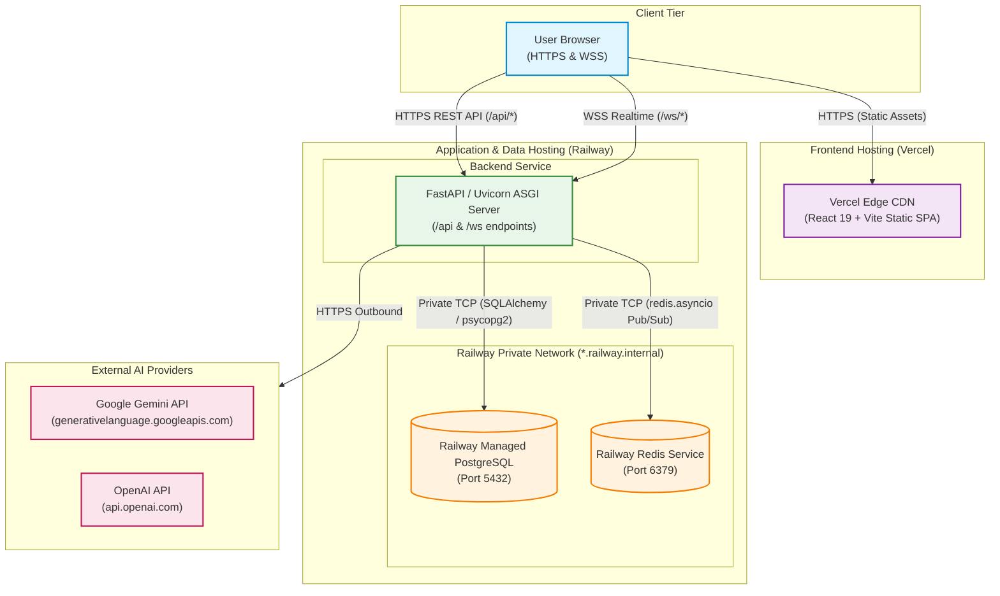

# SynapseLM Cloud Deployment Architecture

This document describes the production cloud architecture for SynapseLM across **Vercel** (Frontend) and **Railway** (Backend, PostgreSQL, Redis).

---

## 1. Architectural Overview

SynapseLM is architected into three logical tiers:

---

## 2. Logical Components

### Component 1: Database & Redis (Persistence & Realtime Messaging)
* **PostgreSQL (Persistent Storage)**:
  - Managed PostgreSQL 15+ running in Railway.
  - Serves as the sole authoritative data store for all persistent state:
    - Users and bcrypt password hashes.
    - Teams, team memberships, and team invitations.
    - Conversations, message history, sequence numbers, and parent/branch hierarchies.
    - Conversation participants, shares (tokens, expiration), and access requests.
    - Per-user encrypted LLM API keys (`user_credentials`).
  - Schema migrations are managed via Alembic (`backend/alembic/`), tracking up to migration head `590e4e31ede3`.
  - Accessible to the backend via Railway's private network using internal hostnames or `${{Postgres.DATABASE_URL}}`.
* **Redis (Realtime Event Bus & Pub/Sub)**:
  - Managed Redis 7+ instance in Railway.
  - Used strictly for transient Pub/Sub event broadcasting across ASGI worker processes and container instances:
    - `conversation:{conversation_id}`: New chat messages, streaming AI token deltas, presence join/leave events, typing notifications.
    - `user:{user_id}`: Access-request decision notifications (accept/reject alerts).
  - **Durability Invariant**: Redis is **non-authoritative**. If Redis restarts or drops cache, active WebSocket subscribers experience a momentary reconnection, but no durable conversation or user data is lost.

### Component 2: Backend (FastAPI on Railway)
* **Framework & ASGI Server**:
  - FastAPI 0.110.1 running on Uvicorn ASGI server.
  - Bound to `0.0.0.0` listening on the provider-assigned dynamic `$PORT`.
  - Configured with `--proxy-headers` and `--forwarded-allow-ips '*'` to properly extract client IP addresses and protocol headers (HTTPS/WSS) from Railway's edge reverse proxy.
* **Core Responsibilities**:
  - **Authentication**: JWT Bearer token generation and validation (`HS256`, 24-hour expiration).
  - **Authorization**: Granular owner, team-member, and shared-participant access controls.
  - **Conversation & Branching Engine**: Single-level snapshot-boundary conversation branching with sequence-based message isolation.
  - **Sharing & Access Requests**: UUID share tokens with optional TTLs, requester workflow, owner review, and notification dispatch.
  - **Per-User Credential Encryption (BYOK)**: User API keys encrypted at rest using AES-128-CBC/Fernet with SHA-256 derived keys via `CREDENTIAL_ENCRYPTION_KEY`. Decrypted strictly in-memory during inference.
  - **LLM Orchestration**: Dual-engine routing supporting Google Gemini (`gemini-3.6-flash`, `gemini-3.8-flash`, etc. via Google REST API) and OpenAI (`gpt-4o`, `gpt-4-turbo` via OpenAI SDK), with fallback to system keys or mock provider.
  - **Health Probes**:
    - `GET /health`: Liveness probe (returns HTTP 200 `{"status": "ok"}`).
    - `GET /health/ready`: Readiness probe (executes `SELECT 1` on PostgreSQL and `ping()` on Redis; returns HTTP 200 or HTTP 503).

### Component 3: Frontend (React / Vite on Vercel)
* **Framework & Build**:
  - React 19 + TypeScript 5.8 + Vite 8.3 + Tailwind CSS 4.0.
  - Compiled to static assets in `dist/` via `tsc -b && vite build`.
  - Deployed to Vercel's global edge network.
* **SPA Routing & Rewrites**:
  - Configured via `frontend/vercel.json` with client-side rewrite fallback to `/index.html` for direct URL navigation (`/conversations/:id`, `/shares/:token`, `/teams/:id`, etc.).
  - Immutable caching headers on `/assets/*` bundles.
* **API & WebSocket Integration**:
  - Communicates directly with Railway backend over HTTPS and WSS using `VITE_API_BASE_URL` and `VITE_WS_BASE_URL`.
  - No secrets bundled into frontend code.

---

## 3. Communication Contracts & Security Invariants

| Flow | Protocol | Security / Auth | Endpoint Pattern |
|---|---|---|---|
| Browser -> Frontend | HTTPS | TLS 1.3 via Vercel Edge | `https://synapselm.vercel.app/*` |
| Browser -> Backend REST | HTTPS | Bearer JWT header (`Authorization: Bearer <token>`) | `https://synapselm.up.railway.app/api/*` |
| Browser -> Backend WS | WSS | JWT Query Parameter (`?token=<jwt>`) | `wss://synapselm.up.railway.app/ws/{id}?token=<jwt>` |
| Backend -> PostgreSQL | TCP (Internal) | Password authentication via private network | `postgresql://...:5432/railway` |
| Backend -> Redis | TCP (Internal) | Password authentication via private network | `redis://...:6379` |
| Backend -> AI Providers | HTTPS | Outbound TLS with API Key in request headers | Google / OpenAI REST APIs |

### Critical Security Invariants
1. **Frontend Isolation**: The frontend **never** connects directly to PostgreSQL or Redis. All data passes through authorized FastAPI routes.
2. **Database Non-Exposure**: PostgreSQL and Redis services in Railway do not require public TCP proxy domains; all backend communication uses Railway private networking (`*.railway.internal`).
3. **CORS Hardening**: `ALLOWED_ORIGINS` on the backend allows only the verified production frontend URL (and custom domains if configured), preventing unauthorized cross-origin browser requests. No wildcard `*` with credentials.
4. **Key Continuity**: `CREDENTIAL_ENCRYPTION_KEY` must remain identical across all deployments. Modifying this key will render all previously saved user API keys undecryptable.
